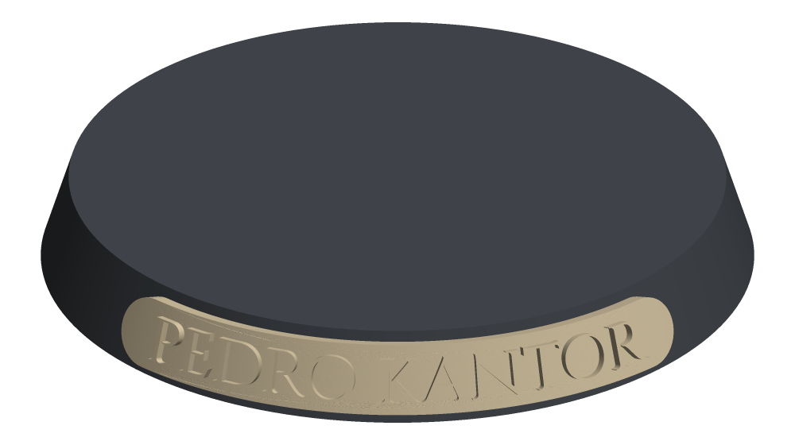
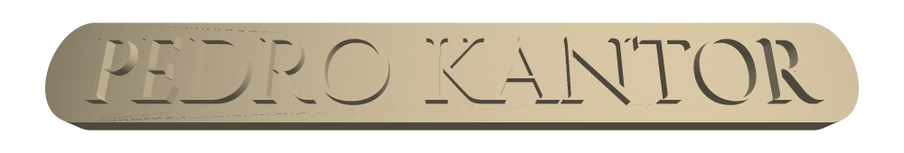

# Warhammer Nameplates

Generate 3D-printable nameplates that sit flush on the sloped rim of a Warhammer miniature's base.





Give it a model's name and its base, and it writes an STL. The nameplate is a strip shaped like a slice of the rim's cone, so its back sits flat against the base and it leans back with the rim's slope. The name is set in raised capitals, ready to drybrush. The plate is as long as the name needs, up to half-way around the base.

## Requirements

- Node.js 22 or later
- A resin printer is recommended. The default letters are 2 mm tall with 0.4 mm relief, which is finer than most FDM printers resolve cleanly.

## Install

```sh
git clone git@github.com:aledegano/warhammer-nameplates.git
cd warhammer-nameplates
npm install
```

## Usage

```sh
npx tsx src/cli.ts "Pedro Kantor" --base 32 -o kantor.stl
```

```
Wrote kantor.stl: 26.7 mm long (99.6° of rim), 3.2 mm strip, 2 mm capitals, 0.8 mm backing + 0.4 mm relief.
```

Load the STL into your slicer (Chitubox, Lychee, …), orient it and add supports as usual, then glue it to the base rim.

### Bases

`--base` picks a preset by nominal diameter:

| Preset | Bottom Ø | Top Ø   | Height |
| ------ | -------- | ------- | ------ |
| `25`   | 25 mm    | 23 mm   | 4 mm   |
| `32`   | 32 mm    | 29.5 mm | 4 mm   |
| `40`   | 40 mm    | 37 mm   | 4 mm   |

These figures are **approximate**: they come from hobbyist sources that don't always agree. For a tight fit, measure your base with calipers and override any of the three dimensions:

```sh
npx tsx src/cli.ts "Pedro Kantor" --base 32 --top-diameter 30.1
npx tsx src/cli.ts "Pedro Kantor" --bottom-diameter 32 --top-diameter 30.1 --height 4.2
```

### Plate options

All sizes are in millimetres. Heights are measured along the rim's slope.

| Option                  | Default         | Meaning                                       |
| ----------------------- | --------------- | --------------------------------------------- |
| `--strip-height <mm>`   | 3.2             | Height of the strip                           |
| `--cap-height <mm>`     | 2               | Height of the capital letters                 |
| `--backing <mm>`        | 0.8             | Thickness of the strip behind the letters     |
| `--relief <mm>`         | 0.4             | How far the letters stand out from the strip  |
| `--end-padding <mm>`    | 2               | Space between the text and each end           |
| `--font <file>`         | bundled Cinzel  | Any TTF/OTF font                              |
| `-o, --output <file>`   | `<name>.stl`    | Where to write the STL                        |

Run `npx tsx src/cli.ts --help` for the full list.

The tool refuses to generate a plate it thinks won't work, and tells you what to change. That includes a name that would reach more than 180° around the rim, a strip taller than the rim's slope, an impossible base profile, and a character the font has no glyph for.

## Development

```sh
npm test            # Vitest: geometry properties of generated nameplates, plus a CLI smoke test
npm run typecheck   # tsc --noEmit
```

The geometry lives in `src/nameplate.ts`. It's a pure function that takes a request (name, base, sizes, font bytes) and returns a triangle mesh and a report. The CLI is a thin wrapper around it. The core uses [manifold-3d](https://github.com/elalish/manifold) and [opentype.js](https://github.com/opentypejs/opentype.js), and has no Node-only dependencies, so a future browser app with live preview can reuse it. See [ADR-0001](docs/adr/0001-typescript-manifold-geometry-core.md).

Domain terms (Nameplate, Base, Rim, Base Profile, Base Preset) are defined in [GLOSSARY.md](GLOSSARY.md). Work is tracked in [GitHub Issues](https://github.com/aledegano/warhammer-nameplates/issues).

## Credits

- The bundled [Cinzel](https://github.com/NDISCOVER/Cinzel) font is © The Cinzel Project Authors. It's used under the SIL Open Font License; see [fonts/cinzel/OFL.txt](fonts/cinzel/OFL.txt).
- This is an unofficial fan project. Warhammer and the names of its characters are trademarks of Games Workshop Ltd. This project is not affiliated with or endorsed by Games Workshop, and it doesn't ship any Games Workshop artwork.
